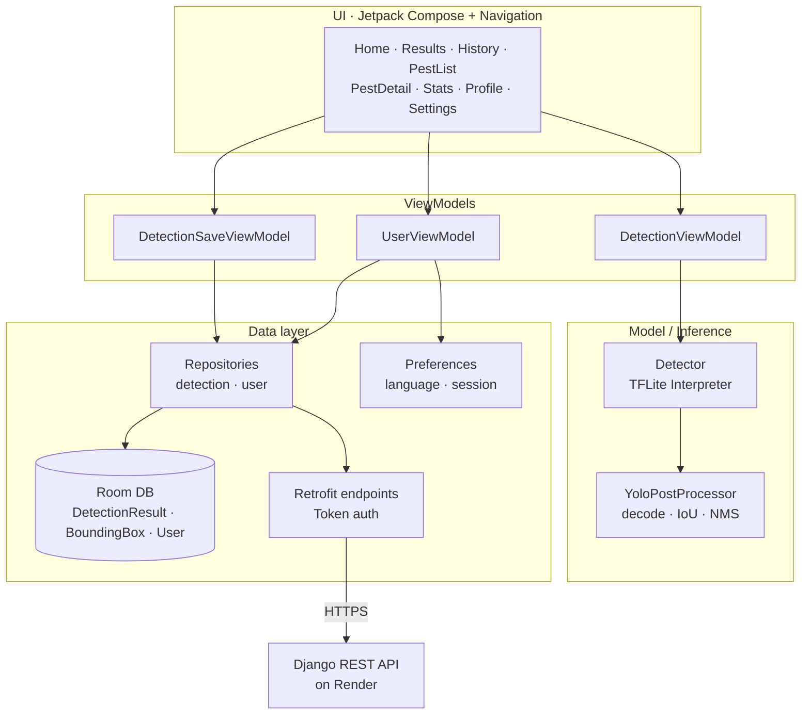
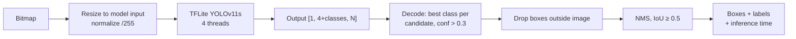

# Pest detection: Android app

A native Android app that detects 13 agricultural pests in real time, fully offline, using a YOLOv11s model (93.8% mAP@50) running on the phone with TensorFlow Lite. For every detected pest it shows the species, a confidence score and recommended treatments. History syncs to the cloud when the phone is back online.

> Part of the [Mobile Agricultural Pest Detection System](https://github.com/MehdiBedja/pest-detection-system):
> [AI research](https://github.com/MehdiBedja/pest-detection-computer-vision) · Android app · [Backend API](https://github.com/MehdiBedja/pest-detection-api)

## Features

- On-device detection: take a photo or pick an image from storage, then run YOLOv11s through TFLite. No network is needed.
- Bounding boxes + confidence drawn over the image, with non-max suppression.
- Treatment recommendations mapped to each detected pest from a bundled pest knowledge base.
- Pest encyclopedia: browse every supported pest with descriptions and control methods.
- Offline-first history: detections, images and notes are stored in Room, then synced to the backend (upload, cross-device restore, soft-delete propagation, last-write-wins notes).
- Statistics dashboard of detections over time (MPAndroidChart).
- Accounts: email/password or Google Sign-In, with change and set password.
- Multilingual: English, French and Arabic (RTL).
- Onboarding, settings and a community forum link.

## Architecture

The app uses MVVM with a repository layer and a single-activity Compose UI.



### Inference pipeline



## Tech stack

| Area | Libraries |
| --- | --- |
| UI | Jetpack Compose, Material 3, Navigation Compose, Coil, Accompanist |
| ML | TensorFlow Lite 2.14, TFLite Support |
| Camera / files | Activity Result API (`TakePicture`, `OpenDocument`) |
| Persistence | Room (KSP) |
| Networking | Retrofit, Gson, OkHttp logging |
| Auth | Google Play Services Auth (Google Sign-In) |
| Charts | MPAndroidChart |

## Build and run

Requirements: Android Studio (Ladybug or newer), JDK 17, Android SDK 35.

```bash
git clone https://github.com/MehdiBedja/pest-detection-android.git
cd pest-detection-android
./gradlew assembleDebug          # APK in app/build/outputs/apk/debug/
./gradlew installDebug           # install on a connected device / emulator
```

Or open the folder in Android Studio and press Run.

The backend URL is set in `app/src/main/java/com/bedjamahdi/scanpestai/network/UrlFile.kt`. Detection works without it; only account and sync features need the API.

## Tests

```bash
./gradlew testDebugUnitTest
```

JVM unit tests cover the YOLO post-processing: class selection, box conversion, the confidence threshold, out-of-bounds filtering, IoU and NMS.

## Project structure

```
app/src/main/java/com/bedjamahdi/scanpestai/
├── model/          # Detector (TFLite), YoloPostProcessor, BoundingBox, OverlayView
├── screen/         # Compose screens + navigation
├── ViewModels/     # MVVM view models
├── repository/     # detection / user repositories
├── RoomDatabase/   # entities, DAOs, database
├── endpoint/       # Retrofit API interfaces
├── preferences/    # session + language preferences
└── components/     # shared UI (sync banner, ...)
app/src/main/assets/  # yolov11s TFLite model, labels, pest info (EN/FR/AR)
```

## Author

Mahdi Bedja · [Portfolio](https://mehdibedja.github.io) · [LinkedIn](https://www.linkedin.com/in/mahdi-bedja-0b94031b3/)
